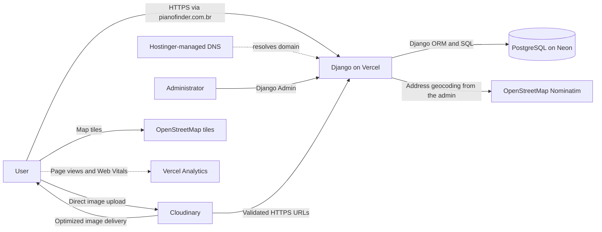

# Piano Finder

A map and catalog of public pianos in Brazil, built from suggestions sent by the people who play them.

[](https://github.com/jvtorlando/piano-finder/actions/workflows/tests.yml)
[](https://github.com/jvtorlando/piano-finder/releases)

[Live site](https://www.pianofinder.com.br/) · [Releases](https://github.com/jvtorlando/piano-finder/releases) · [Changelog](CHANGELOG.md) · [GitHub repository](https://github.com/jvtorlando/piano-finder)

## Why I built it

I wanted to find an acoustic piano I could play in São Paulo, and it was harder than it should be. The information existed, but it was scattered across posts, old articles and word of mouth, and a lot of it was out of date.

I started documenting the search on TikTok. People began sending me places I hadn't heard of, and one of those videos reached 88.9K views. I couldn't visit every suggestion myself, so I turned the idea into a site where anyone can send a piano and I review it before it goes live.

It started in São Paulo, but the form accepts pianos from anywhere in Brazil.

## Live site

The site runs at [www.pianofinder.com.br](https://www.pianofinder.com.br/).

### Catalog

<p align="center">
  
  
</p>

### Piano page and the suggestion form

<p align="center">
  
  
</p>

## The TikTok that started it

Before the site existed, the project was a TikTok profile about public pianos. The screenshot below shows the profile and the 88.9K-view video as they were on August 6, 2026. It's a snapshot from that day, not a live number.

<p align="center">
  
</p>

## What it does

- Shows only pianos that an administrator has approved.
- Filters by state, city and piano type. The list updates in place (HTMX), and the URL can be shared.
- Has a map page with a "near me" button that sorts pianos by distance from where you are.
- Finds the coordinates of each piano from its address with OpenStreetMap Nominatim.
- Lets anyone suggest a piano with up to three photos.
- Crops every photo to 16:10 in the browser before upload (drag, zoom, keyboard and touch all work) and exports it at 1600×1000, so cards look the same on any screen.
- Stores and serves images through Cloudinary.
- Gives each piano a page with address, whether it's working, description, a small map and a Google Maps link.
- Takes likes and one-to-five-star ratings. The stars show the average with partial fill.
- Holds comments for review before they appear.
- Marks the three most-liked pianos as featured.
- Has a moderation dashboard (Django Admin with Unfold) with review queues, pending counters and one-click approval.
- Collects page views and real-user performance with Vercel Web Analytics and Speed Insights, without cookies.

## Architecture



Hostinger is where the domain is registered and where the DNS lives. The app itself runs on Vercel. The database is PostgreSQL on Neon, and images go to Cloudinary because Vercel's filesystem doesn't keep files between requests. When you run it locally without `DATABASE_URL`, Django falls back to SQLite.

## Data model

There are two main tables:

| Model | What it stores | Relationship |
| --- | --- | --- |
| `Piano` | Location, address, coordinates, type, photos, whether it works, votes and ratings | Has many comments |
| `Comentario` | Optional author name, text, date and review status | Belongs to one piano |

Deleting a piano also deletes its comments (the foreign key cascades). Queries go through the Django ORM. Migrations track schema changes and also the seed data the production database needed.

## Technical decisions

### PostgreSQL on Neon

Vercel functions don't keep state, so the data has to live somewhere else. The connection string comes from `DATABASE_URL`; locally I use SQLite so setup takes a minute.

### Cloudinary

Photos from the public form go straight from the browser to Cloudinary, and Django only accepts HTTPS URLs from the Piano Finder Cloudinary account. Photos sent through the admin are checked on the server before they're uploaded to the same account.

### Same frame for every photo

The photo editor shows the final 16:10 frame before anything is uploaded and exports a 1600×1000 JPEG with the Canvas API. The public form and the admin use the same editor.

### Review before publishing

New pianos and comments are saved as pending. Public pages only show approved records.

### Votes that don't get lost

Likes and ratings are updated inside a transaction with `select_for_update()`, so two people voting at the same moment don't overwrite each other.

### Coordinates only from the admin

Nominatim allows one request per second and asks apps to identify themselves. To respect that, the site only looks up coordinates when an administrator saves or approves a piano, or runs the bulk "find coordinates" action. The public form never calls it.

### Limits against abuse

Suggestions, comments, votes and ratings are rate-limited per IP. On top of that: CSRF protection, server-side validation, secure cookies in production, HTTPS redirection and security headers.

## Technology

| Area | Tools |
| --- | --- |
| Backend | Python 3.14, Django 6 |
| Database | PostgreSQL (Neon), SQLite locally |
| Frontend | Django templates, Tailwind CSS v4, HTMX, JavaScript, Canvas API |
| Admin | Django Admin with Unfold |
| Maps | Leaflet, OpenStreetMap tiles, Nominatim |
| Images | Cloudinary |
| Hosting | Vercel, Hostinger DNS, WhiteNoise |
| Analytics | Vercel Web Analytics, Vercel Speed Insights |
| Quality | Django TestCase, GitHub Actions |

## Tests

The tests cover what visitors and administrators actually do: which pianos are visible, filters (including the HTMX responses), validation of state, piano type and Cloudinary URLs, photo uploads in the form and the admin, comment review, switching between like and dislike, rating math, rate limits, the admin dashboard and approval flow, geocoding (with the external service mocked) and the map pages.

Run them with:

```bash
python manage.py test
```

To fill your local database with a few sample pianos and comments:

```bash
python manage.py carregar_exemplos
```

There are 41 tests right now. GitHub Actions runs the same suite on every push to `main` and on pull requests.

## Running it locally

### 1. Clone the repository

```bash
git clone https://github.com/jvtorlando/piano-finder.git
cd piano-finder
```

### 2. Create a virtual environment

Windows PowerShell:

```powershell
python -m venv .venv
.\.venv\Scripts\Activate.ps1
```

Linux or macOS:

```bash
python3 -m venv .venv
source .venv/bin/activate
```

### 3. Install the dependencies

```bash
python -m pip install -r requirements.txt
```

### 4. Create your `.env`

Copy the template. With `DEBUG=True`, the placeholder values are enough to run the site:

```powershell
Copy-Item .env.example .env
```

On Linux or macOS, use `cp .env.example .env`. If you want a real local secret key:

```bash
python -c "from django.core.management.utils import get_random_secret_key; print(get_random_secret_key())"
```

Don't publish `.env` files or paste their values anywhere (issues, commits, screenshots, docs).

### 5. Create the database and start the server

```bash
python manage.py migrate
python manage.py runserver
```

Then open `http://127.0.0.1:8000/`.

### Styles

The CSS is Tailwind, compiled from `assets/tailwind.css` into `static/css/site.css`. The compiled file is committed, so you only need this if you change classes:

```bash
python manage.py tailwind build   # or: python manage.py tailwind watch
```

## Deployment

1. Changes are reviewed in a pull request and merged into `main`.
2. GitHub Actions runs the tests.
3. Vercel builds production with Python 3.14 (from `.python-version`).
4. If `DATABASE_URL` is set, the build runs the Django migrations.
5. WhiteNoise serves static files, Neon keeps the data and Cloudinary keeps the photos.
6. Hostinger DNS points `pianofinder.com.br` and `www.pianofinder.com.br` to Vercel, and the bare domain redirects to `www`.

Production secrets are set in Vercel and never committed. Analytics only loads on Vercel deployments, and only after Web Analytics and Speed Insights are turned on in the Vercel project.

## Versions and releases

The project uses [Semantic Versioning](https://semver.org/). A major version means a big or incompatible change, a minor version adds something without breaking what exists, and a patch fixes bugs.

Each release gets a Git tag (like `v1.0.0`), a GitHub Release with a short summary and an entry in [CHANGELOG.md](CHANGELOG.md), grouped into `Added`, `Changed`, `Fixed` and `Security`. I only tag a release after the tests pass and the production deploy has been checked.

The first release, [`v1.0.0`](https://github.com/jvtorlando/piano-finder/releases/tag/v1.0.0), came out on August 6, 2026.

## Security

- Production starts with `DEBUG=False` unless it's set otherwise.
- Production won't start without `SECRET_KEY`, `DATABASE_URL` and the Cloudinary settings.
- CSRF protection covers forms and JavaScript POST requests.
- In production: HTTPS redirect, HSTS, secure cookies, no MIME sniffing and no framing.
- Image URLs sent by users must belong to the project's Cloudinary account.
- The public form rejects files over 10 MB in the browser; the admin checks the same limit on the server.
- Nothing new appears on the site until an administrator approves it.
- `.env` files, local databases, logs, uploaded media and personal notes stay out of Git.

The unsigned Cloudinary preset is public on purpose, because the browser uploads directly. Its allowed formats, size limit and target folder are restricted in the Cloudinary dashboard.

## Project structure

```text
.github/       continuous integration
assets/        Tailwind source (compiled into static/css/site.css)
CHANGELOG.md   history of each release
docs/images/   screenshots used in this README
mapapianos/    settings, URLs, WSGI/ASGI
pianos/        models, forms, views, admin, templates, migrations and tests
static/        compiled CSS and favicons
.env.example   environment variable template
manage.py      Django commands
pyproject.toml metadata, dependencies and the Vercel build step
```

## Known limitations

- Votes and ratings are tied to the browser session, not to user accounts.
- Moderation happens only in the admin.
- The rate-limit counters live in memory, so they aren't shared between Vercel instances.
- Duplicate suggestions aren't detected automatically yet.
- Geocoding depends on how well OpenStreetMap knows the address. When it can't find one, the coordinates have to be typed in the admin.
- The TikTok numbers in this README are from a specific date, not live.

## What's next

- Record when each piano was last checked.
- Detect duplicate suggestions.
- Move rate-limit counters to a shared store such as Redis.
- Use the analytics data to see which cities and piano types people look for the most.

## Author

Built by [João Vitor Teixeira Orlando](https://github.com/jvtorlando), Computer Science student at Mackenzie Presbyterian University.

It's part of my portfolio for internships and jobs in Data, Analytics and Software Engineering. Working on it, I've used Python, Django and SQL, modeled the data, integrated outside services, written tests, handled security settings and kept a site running in production.

## AI-assisted development

I used OpenAI Codex and Claude Code as assistants while improving the project: for reading and debugging code, refactoring, writing documentation and writing tests. I reviewed and tested every change before keeping it, and I adjusted many of them.

The requirements, the technical choices and checking that the site works were my job, and I can explain the code that's here.
