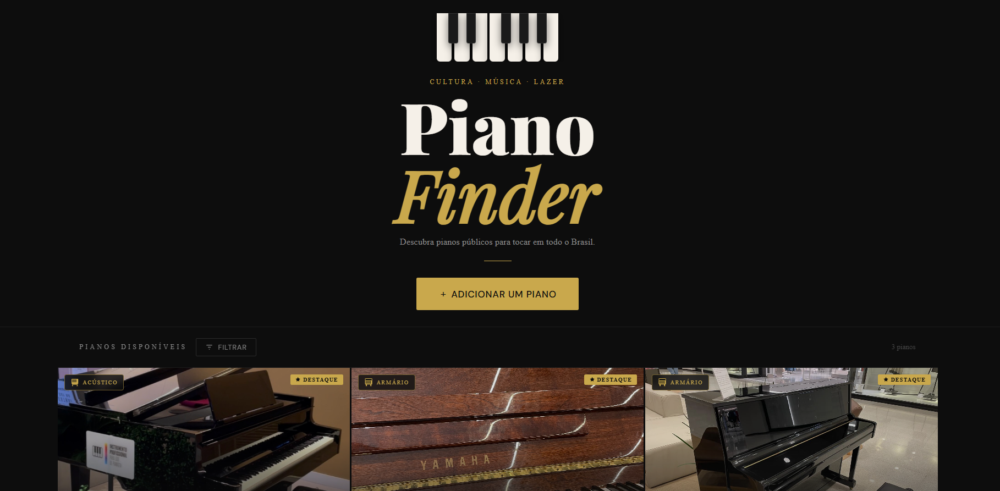
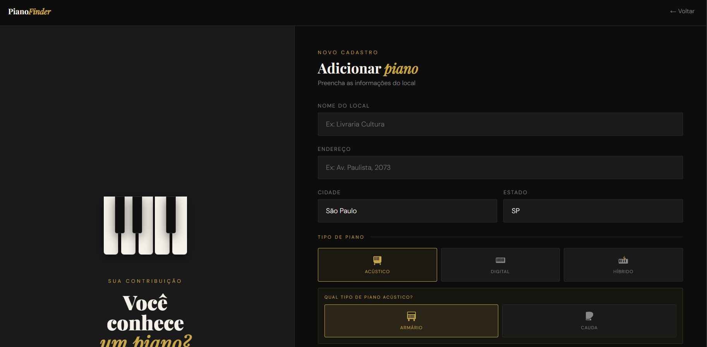
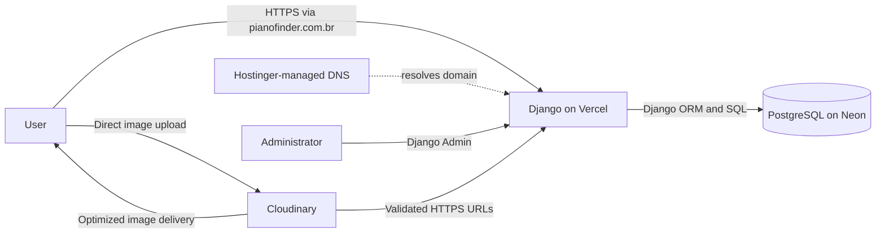

# Piano Finder

A community-driven platform for locating, rating, and documenting publicly accessible pianos across Brazil.

[](https://github.com/jvtorlando/piano-finder/actions/workflows/tests.yml)

[Live application](https://www.pianofinder.com.br/) · [GitHub repository](https://github.com/jvtorlando/piano-finder)

## About the project

Piano Finder started with a real problem: finding an acoustic piano available to play in São Paulo was difficult because the existing information was scattered, incomplete, or outdated.

The search initially became content on TikTok. Community members began suggesting new locations, and one documented search reached **88.9K views**. Since personally verifying every recommendation was not practical, the idea evolved into a collaborative platform where people can register and share publicly accessible pianos.

The project began in São Paulo and was designed to accept contributions from across Brazil. It combines a real community use case with relational data modeling, moderation, third-party services, automated tests, and production deployment.

## Live demo

The production application is available at [www.pianofinder.com.br](https://www.pianofinder.com.br/).

### Responsive catalog

<p align="center">
  
  
</p>

### Piano details and community submission

<p align="center">
  
  
</p>

## Community validation

Piano Finder first grew as a TikTok project documenting public pianos. The response helped validate the problem and motivated the collaborative platform. The image below records the project's public profile and its **88.9K-view video as captured on August 6, 2026**; it is evidence from a specific date rather than a live counter.

<p align="center">
  
</p>

## Features

- public catalog that displays approved pianos only;
- filtering by Brazilian state, city, and piano type;
- community submissions with up to three images;
- image storage and delivery through Cloudinary;
- detail pages with address, availability, description, and Google Maps access;
- likes, dislikes, and one-to-five-star ratings;
- comments subject to moderation;
- automatic selection of the three most-liked pianos as featured locations;
- Django Admin interface for searching, reviewing, and moderating submissions;
- responsive interface for desktop and mobile devices.

## Architecture



Hostinger is the domain registrar and DNS provider; the application itself runs on Vercel. PostgreSQL data is hosted by Neon, while images are stored outside the serverless filesystem in Cloudinary. During local development, Django uses SQLite when `DATABASE_URL` is not configured.

## Data model

The application has two main domain entities:

| Entity | Responsibility | Relationship |
| --- | --- | --- |
| `Piano` | Stores location, address, type, images, availability, votes, and ratings | Has multiple comments |
| `Comentario` | Stores an optional author, text, date, and moderation status | Belongs to one piano through a foreign key |

Django creates the primary keys automatically. The `ForeignKey` relationship provides referential integrity: deleting a piano also removes its related comments.

Application queries use the Django ORM and are translated into SQL. Migrations version both schema changes and the production seed data required by the project.

## Technical decisions

### PostgreSQL and Neon

PostgreSQL keeps production data outside Vercel's ephemeral runtime. The connection is injected through `DATABASE_URL`, while SQLite keeps local setup lightweight.

### Cloudinary

Images do not depend on the application's local filesystem. Public submissions upload directly to Cloudinary and Django accepts only HTTPS image URLs belonging to the configured Piano Finder cloud. Admin uploads are validated server-side before they are sent to the same service.

### Moderation workflow

New piano submissions and comments are stored as pending. Only approved records are visible on public pages.

### Consistent votes and ratings

Vote and rating updates use database transactions and row-level locking with `select_for_update()`. This reduces the risk of lost updates when concurrent requests modify the same piano.

### Abuse prevention

Piano submissions, comments, votes, and ratings have IP-based request limits. The application also uses CSRF protection, server-side validation, production-only secure cookies, HTTPS redirection, and security headers.

## Technology stack

| Area | Technologies |
| --- | --- |
| Backend | Python 3.14, Django 6 |
| Database | PostgreSQL, Neon, SQLite |
| Frontend | HTML, CSS, JavaScript |
| Images | Cloudinary |
| Infrastructure | Vercel, Hostinger DNS, Neon, Cloudinary, WhiteNoise |
| Quality | Django TestCase, GitHub Actions, migrations, Git, GitHub |

## Automated tests

The suite covers the main user flows and business rules, including:

- visibility of approved and pending pianos;
- catalog filters;
- Brazilian state, piano type, and Cloudinary URL validation;
- public and admin image-upload behavior;
- comment moderation;
- switching between likes and dislikes;
- rating calculations;
- request limits.

Run it locally with:

```bash
python manage.py test
```

The project currently has **17 automated tests**. GitHub Actions runs the same suite on pushes to `main` and on pull requests.

## Running locally

### 1. Clone the repository

```bash
git clone https://github.com/jvtorlando/piano-finder.git
cd piano-finder
```

### 2. Create and activate a virtual environment

Windows PowerShell:

```powershell
python -m venv .venv
.\.venv\Scripts\Activate.ps1
```

Linux or macOS:

```bash
python3 -m venv .venv
source .venv/bin/activate
```

### 3. Install the dependencies

```bash
python -m pip install -r requirements.txt
```

### 4. Configure the environment

Copy the safe template and fill in only your local values:

```powershell
Copy-Item .env.example .env
```

On Linux or macOS, use `cp .env.example .env`. Generate a local Django key with:

```bash
python -c "from django.core.management.utils import get_random_secret_key; print(get_random_secret_key())"
```

Never publish `.env` files or paste their values into issues, commits, screenshots, or documentation.

### 5. Prepare the database and run the application

```bash
python manage.py migrate
python manage.py runserver
```

Open `http://127.0.0.1:8000/`.

## Deployment

1. Changes are reviewed and merged into `main`.
2. GitHub Actions runs the Django test suite.
3. Vercel builds the production deployment using Python 3.14 from `.python-version`.
4. The production build applies Django migrations when `DATABASE_URL` is available.
5. WhiteNoise serves static assets, Neon persists relational data, and Cloudinary stores uploaded images.
6. Hostinger DNS maps `pianofinder.com.br` and `www.pianofinder.com.br` to Vercel; the apex domain redirects to `www`.

Production secrets are configured in Vercel and are never committed to the repository.

## Security

- production starts with `DEBUG=False` unless explicitly configured otherwise;
- production refuses to start without `SECRET_KEY`, `DATABASE_URL`, and the required Cloudinary settings;
- CSRF middleware protects form and JavaScript POST requests;
- HTTPS redirect, HSTS, secure cookies, MIME sniffing protection, and frame denial are enabled in production;
- user-provided image URLs are restricted to the configured Cloudinary account;
- the public form rejects files over 10 MB in the browser, while the Admin enforces the same limit server-side;
- new content remains pending until an administrator approves it;
- `.env` files, local databases, logs, uploaded media, and personal notes are excluded from Git.

The unsigned Cloudinary preset is intentionally public for browser uploads. Its allowed formats, maximum file size, and target folder must also remain restricted in the Cloudinary dashboard.

## Project structure

```text
.github/       continuous integration workflow
docs/images/   README screenshots and community evidence
mapapianos/    settings, URLs, and WSGI/ASGI entry points
pianos/        models, forms, views, admin, migrations, and tests
static/        project static files
.env.example   safe environment-variable template
manage.py      Django administrative commands
pyproject.toml project metadata, dependencies, and Vercel build setup
```

## Current limitations

- votes and ratings are tracked by session rather than authenticated user accounts;
- moderation depends on the administrative interface;
- the in-memory rate-limit cache is not shared across serverless instances;
- duplicate piano submissions are not yet detected automatically;
- locations do not yet store latitude and longitude in the database;
- community metrics shown in the README are dated snapshots, not live analytics.

## Next steps

- add geographic search and map visualization;
- record when each piano was last verified;
- add duplicate-submission detection;
- move rate-limit counters to a shared store such as Redis;
- create analytics for cities, piano types, and instrument availability.

## Author

Developed by [João Vitor Teixeira Orlando](https://github.com/jvtorlando), a Computer Science student at Mackenzie Presbyterian University.

This project is part of my portfolio for opportunities in Data, Analytics, and Software Engineering. It demonstrates practical experience with Python, Django, SQL, relational data modeling, service integrations, automated tests, security controls, and production deployment.

## AI-assisted development

OpenAI Codex and Claude Code were used as development assistants during the improvement of this project.

The tools supported code analysis, debugging, refactoring, documentation and test creation. All suggested changes were reviewed, tested and adapted before being incorporated into the project.

I remained responsible for defining requirements, evaluating technical decisions, validating the application and understanding the implemented code.
