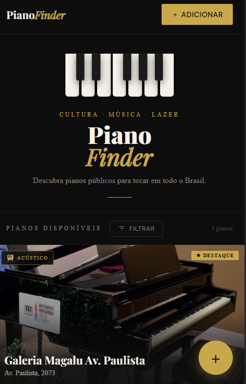
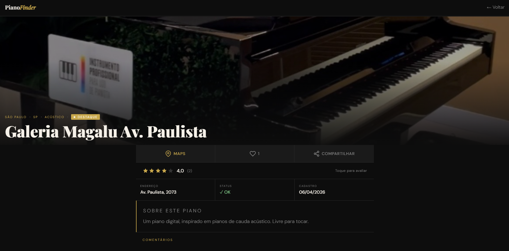
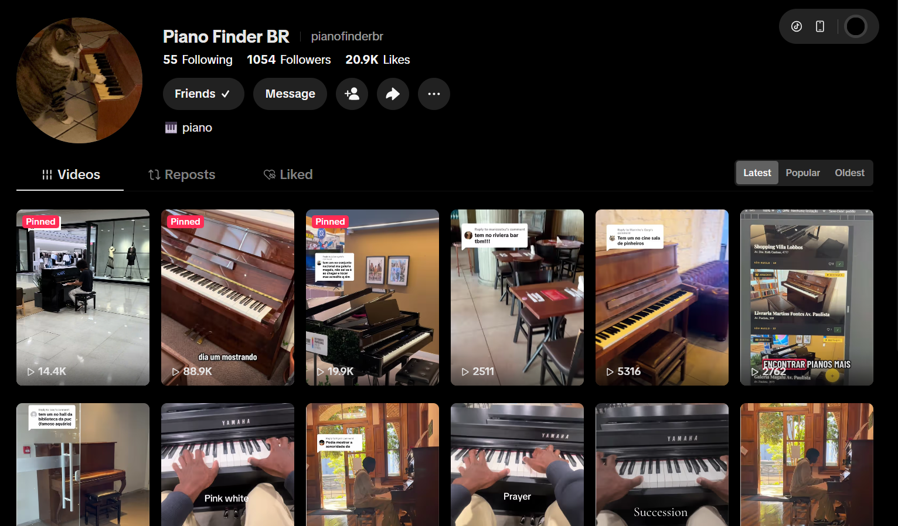
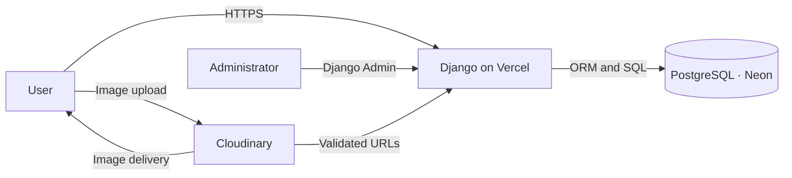

# Piano Finder

A community-driven platform for locating, rating, and documenting publicly accessible pianos across Brazil.

[Live application](https://piano-finder-seven.vercel.app/) · [GitHub repository](https://github.com/jvtorlando/piano-finder)

## About the project

Piano Finder started with a real problem: finding an acoustic piano available to play in São Paulo was difficult because the existing information was scattered, incomplete, or outdated.

The search initially became content on TikTok. One of the videos reached **88.9K views**, and the community began suggesting new locations. Since visiting and personally verifying every recommendation was not practical, the idea evolved into a platform where users can register and share publicly accessible pianos themselves.

The project started in São Paulo and was designed to accept community contributions from across Brazil.

## Demo

The deployed application is available at [piano-finder-seven.vercel.app](https://piano-finder-seven.vercel.app/).

### Responsive catalog

<p align="center">
  
  
</p>

### Piano details and community submission

<p align="center">
  
  
</p>

## Community validation

Piano Finder first grew as a TikTok project for documenting publicly accessible pianos. The community response helped validate the problem and motivated the development of a collaborative platform. One of the documented searches reached **88.9K views**.

<p align="center">
  
</p>

## Features

- public catalog that displays approved pianos only;
- filtering by Brazilian state, city, and piano type;
- community submissions with up to three images;
- image storage and delivery through Cloudinary;
- detail pages with address, availability, description, and Maps access;
- likes, dislikes, and star ratings;
- comments subject to moderation;
- automatic selection of the three most-liked pianos as featured locations;
- administrative interface for searching, reviewing, and moderating submissions;
- responsive interface for desktop and mobile devices.

## Architecture



In production, the application uses PostgreSQL hosted by Neon. During local development, Django falls back to SQLite when `DATABASE_URL` is not configured.

## Data model

The application has two main domain entities:

| Entity | Responsibility | Relationship |
| --- | --- | --- |
| `Piano` | Stores location, address, type, images, availability, votes, and ratings | Has multiple comments |
| `Comentario` | Stores an optional author, text, date, and moderation status | Belongs to one piano through a foreign key |

Django creates the primary keys automatically. The relationship between comments and pianos uses a `ForeignKey`, providing referential integrity: when a piano is deleted, its related comments are deleted as well.

Queries are written with the Django ORM and translated into SQL by the framework. Migrations version both database schema changes and required data changes.

## Technical decisions

### PostgreSQL and Neon

PostgreSQL keeps production data outside Vercel's ephemeral runtime. The connection is provided through `DATABASE_URL`, while SQLite makes local development straightforward.

### Cloudinary

Images do not depend on the application's local filesystem. The submission form accepts only HTTPS URLs that belong to the Cloudinary account configured for Piano Finder.

### Moderation workflow

New piano submissions and comments are stored as pending. Only approved records are available on public pages.

### Consistent votes and ratings

Like and rating updates use database transactions and row-level locking with `select_for_update()`. This reduces the risk of lost updates when concurrent requests modify the same piano.

### Abuse prevention

Piano submissions, comments, votes, and ratings have IP-based request limits. The project also uses Django's CSRF protection, server-side validation, and secure cookie and HTTPS settings in production.

## Technology stack

| Area | Technologies |
| --- | --- |
| Backend | Python 3.12+, Django 6 |
| Database | PostgreSQL, Neon, SQLite |
| Frontend | HTML, CSS, JavaScript |
| Images | Cloudinary |
| Infrastructure | Vercel, Neon, Cloudinary, WhiteNoise |
| Quality | Django TestCase, migrations, Git, GitHub |

## Tests

The automated test suite covers the main user flows and business rules, including:

- displaying approved pianos only;
- catalog filters;
- Brazilian state, piano type, and image URL validation;
- comment moderation;
- switching between likes and dislikes;
- rating calculations;
- request limits.

Run the tests with:

```bash
python manage.py test
```

The project currently has **14 automated tests**.

## Running locally

### 1. Clone the repository

```bash
git clone https://github.com/jvtorlando/piano-finder.git
cd piano-finder
```

### 2. Create and activate a virtual environment

Windows PowerShell:

```powershell
python -m venv .venv
.\.venv\Scripts\Activate.ps1
```

Linux or macOS:

```bash
python3 -m venv .venv
source .venv/bin/activate
```

### 3. Install the dependencies

```bash
python -m pip install -r requirements.txt
```

### 4. Configure the environment variables

Create a `.env` file in the project root:

```env
SECRET_KEY="generate-a-secure-local-key"
DEBUG=True
ALLOWED_HOSTS=127.0.0.1,localhost
CSRF_TRUSTED_ORIGINS=

# Required for image uploads
CLOUDINARY_CLOUD_NAME=
CLOUDINARY_API_KEY=
CLOUDINARY_API_SECRET=
CLOUDINARY_UPLOAD_PRESET=pianos_unsigned

# Optional locally; without this variable, the project uses SQLite
DATABASE_URL=
```

Never publish the `.env` file or share its values. The file is already listed in `.gitignore`.

### 5. Prepare the database and start the application

```bash
python manage.py migrate
python manage.py runserver
```

Open `http://127.0.0.1:8000/`.

## Project structure

```text
mapapianos/     settings, URLs, and WSGI/ASGI entry points
pianos/         models, forms, views, admin, migrations, and tests
static/         project static files
manage.py       Django administrative commands
pyproject.toml  project metadata, dependencies, and Vercel build setup
```

## Current limitations

- votes and ratings are tracked by session rather than individual user accounts;
- moderation depends on the administrative interface;
- rate limiting uses in-memory cache and is configured for a single worker;
- locations do not yet store latitude and longitude in the database;
- the repository does not yet have a public continuous integration pipeline.

## Next steps

- add geographic search and map visualization;
- record when each piano was last verified;
- build indicators for cities, piano types, and instrument availability;
- improve duplicate-submission prevention;
- add continuous integration for tests and quality checks.

## Author

Developed by [João Vitor Teixeira Orlando](https://github.com/jvtorlando), a Computer Science student at Mackenzie Presbyterian University.

This project is part of my portfolio for opportunities in Data, Analytics, and Software Engineering. It demonstrates practical experience with Python, Django, SQL, relational data modeling, service integrations, automated tests, and deployment.

## AI-assisted development

OpenAI Codex and Claude Code were used as development assistants during the improvement of this project.

The tools supported code analysis, debugging, refactoring, documentation and test creation. All suggested changes were reviewed, tested and adapted before being incorporated into the project.

I remained responsible for defining requirements, evaluating technical decisions, validating the application and understanding the implemented code.
